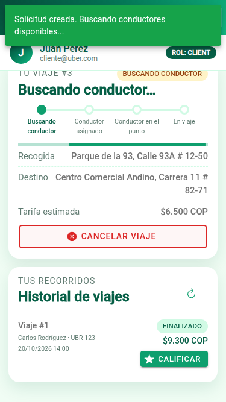
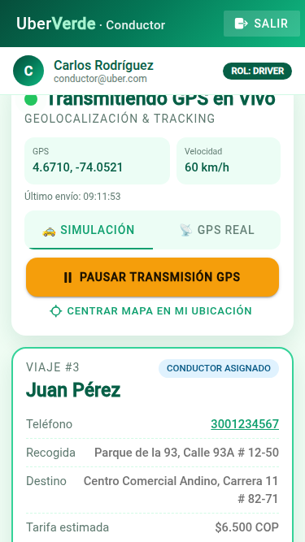
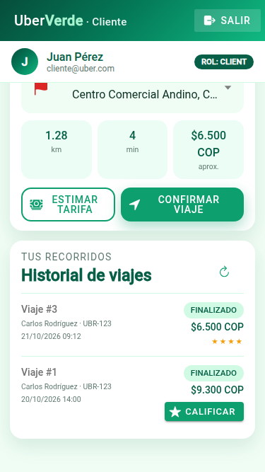
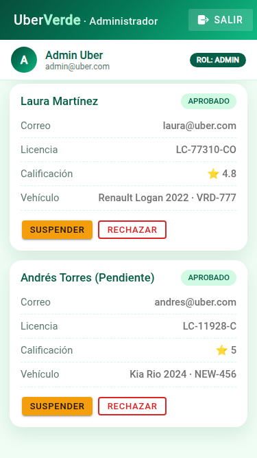

# 🧪 Documentación de pruebas — Uber Verde

**Fecha de ejecución:** 21/10/2026 · **Autor:** Daniel Rojas Arevalo

Se hicieron **4 tipos de prueba**. Todas pasan en la última ejecución:

| Tipo | Herramienta | Qué valida | Resultado |
|---|---|---|---|
| Integración de la API | `node:test` | Que el backend (mock) cumple cada endpoint y regla de `API_DOCUMENTATION.md` | **25 / 25 ✔** |
| Unitarias del frontend | Vitest (`ng test`) | Servicios, interceptor JWT, guards, cálculos y página de login | **43 / 43 ✔** |
| End-to-end (E2E) | Playwright (Chrome headless, 375×667) | Flujo completo de los 3 roles en el navegador | **14 / 14 ✔** |
| Estática | ESLint + `ng build` producción | Calidad del código y que compile | **0 errores ✔** |

### Entorno

| | Versión |
|---|---|
| Node / npm | 22.22.1 / 9.2.0 |
| Angular / Ionic | 21.2.8 / 9.0.4 |
| Leaflet | 1.9.4 |
| Vitest / TypeScript | 4.1.11 / 5.9.3 |
| Navegador E2E | Google Chrome 154 (headless), tamaño iPhone SE 375×667 |
| Sistema | Linux (Ubuntu) |

### Cómo repetir las pruebas

```bash
# Integración de la API
cd mock-backend && npm test

# Unitarias + lint + build del frontend
cd frontend && npm run test:ci && npm run lint && npx ng build

# E2E: levantar el mock y la app, y correr el script con un runner de Playwright
cd mock-backend && npm start          # terminal 1 (datos limpios en cada arranque)
cd frontend && npm start              # terminal 2
node browser.mjs http://localhost:4200/login --script e2e/flujo-completo.e2e.mjs   # terminal 3
```

> El mock reinicia sus datos cada vez que arranca. La prueba E2E espera datos limpios,
> así que hay que reiniciar el mock antes de repetirla.

---

## 1. Pruebas de integración de la API (`mock-backend/server.test.mjs`)

Cada prueba arranca un servidor nuevo en un puerto libre y le hace peticiones HTTP reales con `fetch`.

| ID | Endpoint | Caso | Esperado | Resultado |
|---|---|---|---|---|
| API-01 | `POST /auth/login` | Login con correo | 200, `access_token`, `token_type: bearer`, `expires_in: 3600` | ✔ |
| API-02 | `POST /auth/login` | Login con teléfono | 200 con el mismo usuario | ✔ |
| API-03 | `POST /auth/login` | Clave incorrecta | **401** | ✔ |
| API-04 | `POST /auth/register` | Registro de cliente | **201**, usuario `active` | ✔ |
| API-05 | `POST /auth/register` | Registro de conductor | 201, conductor `pending` con su vehículo | ✔ |
| API-06 | `POST /auth/register` | Correo repetido / clave corta | **422** con `errors.email` / `errors.password` | ✔ |
| API-07 | `GET /auth/me` | Sin token / con token | **401** / 200 con perfil de conductor | ✔ |
| API-08 | `POST /auth/logout` | Cerrar sesión | 200 y el token queda inválido (401 después) | ✔ |
| API-09 | `POST /auth/forgot-password` | Restablecer clave | La clave vieja da 401 y la nueva funciona | ✔ |
| API-10 | `GET /fares/active` | Tarifa pública | "Tarifa Estándar Urbana", mínima 6.500 | ✔ |
| API-11 | `POST /client/estimate-fare` | Ejemplo del documento | **1.28 km, 4 min, $6.500** (igual al documento) | ✔ |
| API-12 | `GET /client/active` | Un conductor entra a ruta de cliente | **403** | ✔ |
| API-13 | `POST /client/ride-requests` | Solicitar dos veces | 201 y luego **400** con `active_request_id` | ✔ |
| API-14 | `POST /client/ride-requests` | Sin coordenadas | **422** | ✔ |
| API-15 | `POST /client/cancel/{id}` | Cancelar solicitud pendiente | 200 y ya no hay viaje activo | ✔ |
| API-16 | `GET /client/trips` | Historial | Paginado en `trips.data`, con conductor y placa | ✔ |
| API-17 | `PUT /driver/availability` | Conductor pendiente | **403** con `approval_status: pending` | ✔ |
| API-18 | Flujo completo | solicitar → aceptar → llegar → iniciar → GPS → finalizar → calificar | Estados correctos; no se puede iniciar sin llegar (400); no se cancela en curso (400); la ubicación GPS llega al cliente; conductor vuelve a `available`; no se califica dos veces (400) | ✔ |
| API-19 | `POST /driver/ride-requests/{id}/accept` | **Dos conductores aceptan a la vez** (RNF-05) | Uno **200** y el otro **409** con el mensaje del documento | ✔ |
| API-20 | `POST /client/trips/{id}/rating` | Calificar viaje no finalizado | **400** | ✔ |
| API-21 | `GET /admin/dashboard` | KPIs | Exactamente los del documento (3 clientes, 3 conductores, 1 pendiente, 2 completados, $15.800) | ✔ |
| API-22 | `GET /admin/drivers` + `PATCH …/approval` | Filtrar pendientes y aprobar | Tras aprobar, el conductor sí puede ponerse disponible | ✔ |
| API-23 | `POST /admin/fares` | Crear tarifa activa | Pasa a ser la tarifa pública | ✔ |
| API-24 | `GET /admin/trips`, `/reports`, `/audit-logs` | Filtros por conductor, estado y fecha | Cantidades correctas; auditoría registra el login | ✔ |
| API-25 | `GET /admin/dashboard` | Un cliente entra a admin | **403** | ✔ |

Salida de la ejecución:

```
# tests 25
# suites 4
# pass 25
# fail 0
```

---

## 2. Pruebas unitarias del frontend (Vitest)

Las peticiones HTTP se interceptan con `HttpTestingController`: se revisa la **URL, el método y el cuerpo exactos**
que se enviarían a Laravel, sin necesitar el servidor.

| ID | Archivo | Qué prueba | Resultado |
|---|---|---|---|
| FE-01 | `core/utils/geo.spec.ts` | Haversine Parque 93 → Andino = 1.28 km | ✔ |
| FE-02 | 〃 | Duración a 20 km/h = 4 min, mínimo 1 | ✔ |
| FE-03 | 〃 | Se aplica la tarifa mínima (6.400 → 6.500) | ✔ |
| FE-04 | 〃 | Tarifa normal (7.113) y con multiplicador 1.3 (17.940) | ✔ |
| FE-05 | 〃 | La simulación GPS avanza la distancia pedida sin pasarse | ✔ |
| FE-06 | 〃 | Rumbo (`heading`) en grados | ✔ |
| FE-07 | `core/utils/format.spec.ts` | Status 0 → "No se pudo conectar con el servidor" | ✔ |
| FE-08 | 〃 | 422 de Laravel → primer mensaje de `errors` | ✔ |
| FE-09 | 〃 | 409 → mensaje del backend | ✔ |
| FE-10 | 〃 | Sin mensaje → texto de la tabla de códigos HTTP | ✔ |
| FE-11 | 〃 | Formato `$6.500 COP` y colores de estado | ✔ |
| FE-12 | `core/services/auth.service.spec.ts` | Login envía `{login, password}` y guarda token | ✔ |
| FE-13 | 〃 | La sesión sobrevive a recargar la página | ✔ |
| FE-14 | 〃 | Logout borra la sesión aunque el backend dé 401 | ✔ |
| FE-15 | 〃 | Forgot-password envía `email` y `new_password` | ✔ |
| FE-16 | 〃 | Cada rol va a su pantalla | ✔ |
| FE-17 | `core/services/api-services.spec.ts` | `estimate-fare` | ✔ |
| FE-18 | 〃 | Historial desempaqueta `trips.data` | ✔ |
| FE-19 | 〃 | Cancelar y calificar con el id en la URL | ✔ |
| FE-20 | 〃 | Disponibilidad por **PUT** | ✔ |
| FE-21 | 〃 | accept → arrive → start → complete (cuerpo del complete) | ✔ |
| FE-22 | 〃 | Filtro `?approval_status` solo si hay valor | ✔ |
| FE-23 | 〃 | Filtros vacíos de viajes no se envían | ✔ |
| FE-24 | 〃 | Aprobación por **PATCH** | ✔ |
| FE-25 | 〃 | Lista simple o paginada | ✔ |
| FE-26 | 〃 | Cambiar la IP del servidor | ✔ |
| FE-27 | `core/interceptors/auth.interceptor.spec.ts` | Sin sesión: solo `Accept: application/json` | ✔ |
| FE-28 | 〃 | Con sesión: `Authorization: Bearer <token>` | ✔ |
| FE-29 | 〃 | 401 → borra sesión y va a `/login` | ✔ |
| FE-30 | 〃 | 401 en el login (clave mala) **no** redirige | ✔ |
| FE-31 | `core/guards/role.guard.spec.ts` | Sin sesión → `/login` | ✔ |
| FE-32 | 〃 | Cliente entra a `/client` | ✔ |
| FE-33 | 〃 | Conductor en `/admin` → `/driver` | ✔ |
| FE-34 | 〃 | Con sesión, `/login` salta a su pantalla | ✔ |
| FE-35 | `pages/login/login.page.spec.ts` | Se ven las 4 cuentas del ingreso rápido | ✔ |
| FE-36 | 〃 | "Cargar" llena el formulario sin enviar | ✔ |
| FE-37 | 〃 | "Entrar" inicia sesión y navega | ✔ |
| FE-38 | 〃 | Credenciales inválidas muestran el mensaje | ✔ |
| FE-39 | 〃 | Clave corta se valida antes de llamar al backend | ✔ |
| FE-40 | 〃 | Cliente se registra sin campos de vehículo | ✔ |
| FE-41 | `pages/driver/driver.page.spec.ts` | Usa las coordenadas del backend | ✔ |
| FE-42 | 〃 | Si solo llega el nombre del lugar, lo busca | ✔ |
| FE-43 | 〃 | Lugar desconocido → sin ruta | ✔ |

Salida de la ejecución:

```
 Test Files  8 passed (8)
      Tests  43 passed (43)
```

---

## 3. Prueba end-to-end (`e2e/flujo-completo.e2e.mjs`)

Un navegador Chrome automatizado, en tamaño de celular, hace lo mismo que haría una persona.

| ID | Paso | Resultado obtenido | Captura |
|---|---|---|---|
| E2E-01 | Abrir el login | Pestañas Iniciar sesión / Registrarse e ingreso rápido por rol | [01](docs/capturas/01-login.png), [02](docs/capturas/02-ingreso-rapido.png) |
| E2E-02 | Clave incorrecta | Toast: "Credenciales inválidas. Verifique su correo/teléfono y contraseña." | — |
| E2E-03 | Cliente estima tarifa | "Estimación del servidor" = **$6.500 COP** | [03](docs/capturas/03-cliente-solicitar.png), [04](docs/capturas/04-cliente-estimacion.png) |
| E2E-04 | Cliente confirma viaje | Estado "Buscando conductor" con barra de progreso | [05](docs/capturas/05-cliente-buscando.png) |
| E2E-05 | Conductor se pone en línea | Banner "Disponibilidad cambiada a: En línea" y aparece la solicitud | [06](docs/capturas/06-conductor-disponible.png) |
| E2E-06 | Conductor acepta | Tarjeta del viaje y transmisión GPS activa | [07](docs/capturas/07-conductor-viaje-asignado.png) |
| E2E-07 | Llegué → Iniciar viaje | Estados cambian; "Último envío" del GPS se actualiza; el carro se mueve en el mapa | [08](docs/capturas/08-conductor-gps-en-vivo.png) |
| E2E-08 | Finalizar viaje | "Viaje finalizado. Tarifa: $6.500 COP" | — |
| E2E-09 | Cliente califica 4★ | "¡Gracias por calificar tu viaje!" y estrellas en el historial | [09](docs/capturas/09-cliente-calificar.png), [10](docs/capturas/10-cliente-historial.png) |
| E2E-10 | Conductor pendiente intenta conectarse | "Solo conductores aprobados pueden activar su disponibilidad." y el interruptor vuelve a apagado | [11](docs/capturas/11-conductor-pendiente.png) |
| E2E-11 | Panel del administrador | Ingresos totales **$22.300 COP** (15.800 iniciales + 6.500 del viaje de la prueba) | [12](docs/capturas/12-admin-panel.png) |
| E2E-12 | Admin aprueba a Andrés | "Conductor actualizado a: approved" | [13](docs/capturas/13-admin-conductores.png) |
| E2E-13 | Auditoría | 10 registros (logins, logouts, aprobación) | [14](docs/capturas/14-admin-auditoria.png) |
| E2E-14 | Admin abre `/client` | El guard lo devuelve a `/admin` | — |

Errores de consola durante la corrida: solo el **401** (E2E-02) y el **403** (E2E-10), que la prueba provoca a propósito.

<p align="center">
  
  
  
  
</p>

---

## 4. Errores encontrados por las pruebas y cómo se corrigieron

| # | Encontrado en | Problema | Corrección |
|---|---|---|---|
| 1 | Build | El pipe `date` no aceptaba `created_at` de la auditoría (tipo `unknown`) | Se convirtió el valor con `$any()` en la plantilla |
| 2 | Unitarias (FE-40) | Tras registrarse, la prueba intentaba navegar a `/client`, que no existe en el entorno de prueba | Se espía `Router.navigateByUrl` y además se verifica a dónde navega |
| 3 | Lint | Se usaba `!=` en una plantilla | Se cambió por `!==` |
| 4 | E2E | El conductor **pendiente** consultaba `/driver/ride-requests` cada 5 s y recibía 403 en cada intento | Ahora solo consulta si está en línea y sin viaje (`filter` de RxJS) |
| 5 | E2E (captura) | "Ingresos de hoy" del conductor Andrés mostraba lo que ganó Carlos en el mismo navegador | Las llaves de `localStorage` ahora incluyen el id del conductor |
| 6 | E2E (captura) | Los títulos de las tarjetas salían pequeños (Ionic pisa los `h2`) y el estado decía "PENDING" | CSS más específico y el estado usa la traducción ("Pendiente") |
| 7 | Revisión del código | Si el 403 llegaba con el interruptor ya marcado como `unavailable`, el interruptor se quedaba encendido | Se apaga el `ion-toggle` directamente cuando hay error |

## 5. Observaciones sobre la API documentada

- **Tarifa final del ejemplo:** el documento muestra `final_fare: 6500` para 1.45 km y 6 min, pero con la tarifa estándar
  la fórmula da 3.800 + 1.45·1.250 + 6·250 = **7.113**. El mock usa la fórmula (prueba API-18). Hay que confirmar con el
  backend real cómo calcula la tarifa definitiva; el frontend solo muestra lo que el backend responde.
- **`GET /driver/ride-requests`** en el documento no trae coordenadas. El frontend las usa si llegan y, si no, las busca
  por el nombre del lugar (pruebas FE-41 a FE-43).
- No hay un endpoint para que el conductor consulte su viaje en curso; el frontend lo guarda en el dispositivo
  para no perderlo si se recarga la página.
- `GET /admin/reports` y `GET /admin/audit-logs` no tienen formato de respuesta en el documento; la app los muestra
  de forma genérica (clave → valor).
- Las pruebas se ejecutaron contra el **mock**, no contra el backend Laravel del profesor. Al conectar el backend
  real se recomienda repetir la prueba E2E cambiando la URL del servidor en el login.
