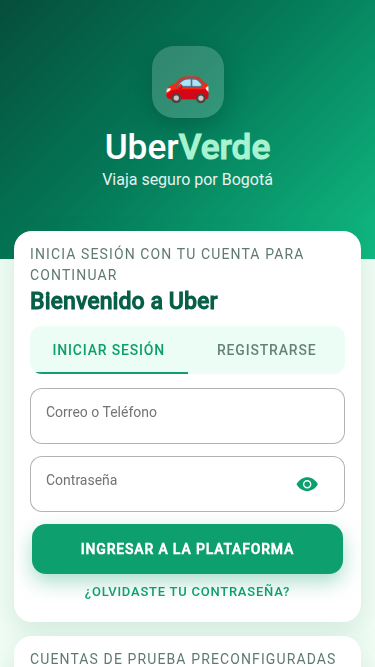
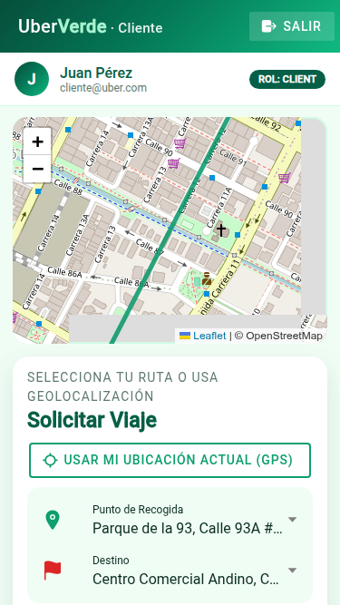
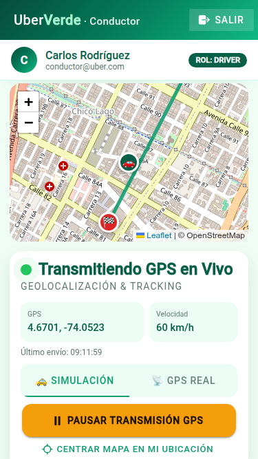
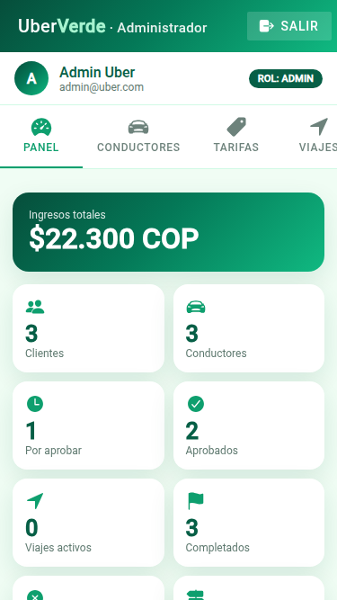

# 🚗 Uber Verde — Frontend Ionic para la API REST Uber

Frontend móvil en **Ionic 9 + Angular 21** (tema verde) que consume la API REST
**Laravel 12 + JWT + PostgreSQL 18** descrita en [`API_DOCUMENTATION.md`](API_DOCUMENTATION.md).
El diseño sigue lo mostrado en clase (video del 21/10/2026): login con *Ingreso rápido por rol*,
pantalla de cliente con mapa y "Solicitar viaje", y pantalla de conductor con "Transmitiendo GPS en vivo".

| Carpeta | Qué contiene |
|---|---|
| `frontend/` | App Ionic/Angular (código, pruebas unitarias) |
| `mock-backend/` | Servidor Node **sin dependencias** que imita la API Laravel (para probar sin PHP/PostgreSQL) + pruebas de la API |
| `e2e/` | Prueba de punta a punta en el navegador |
| `docs/capturas/` | Capturas generadas por la prueba E2E |
| [`PRUEBAS.md`](PRUEBAS.md) | **Documentación de todas las pruebas** y sus resultados |

<p align="center">
  
  
  
  
</p>

## Cómo ejecutar

```bash
# 1. Backend (elige uno)
#    a) El backend Laravel del profesor:  php artisan serve --host=0.0.0.0 --port=8000
#    b) El mock incluido:
cd mock-backend
npm start                 # http://127.0.0.1:8000/api

# 2. Frontend (otra terminal)
cd frontend
npm install
npm start                 # http://localhost:4200  (en Chrome: F12 → modo celular)
```

Si el backend corre en otro computador, en el login toca **"Servidor: …"** y escribe
`http://IP_Servidor:8000/api`. Se guarda en el dispositivo.

### Cuentas de prueba (botones "Entrar" / "Cargar" del login)

| Rol | Correo | Clave |
|---|---|---|
| Pasajero | cliente@uber.com | cliente123 |
| Conductor aprobado | conductor@uber.com | conductor123 |
| Conductor pendiente | andres@uber.com | conductor123 |
| Administrador | admin@uber.com | admin123 |

## Funcionalidades por rol

**Todos** — iniciar sesión con correo o teléfono, registrarse como pasajero o conductor (con licencia y vehículo),
restablecer contraseña, cerrar sesión (el token va a la lista negra). Si el token vence (401) la app vuelve al login.

**Pasajero (`/client`)**
- Mapa (Leaflet + OpenStreetMap) con la ruta origen → destino.
- Origen por GPS del celular o por lugares de Bogotá; vista previa local (Haversine) y estimación del servidor con desglose.
- Confirmar viaje (si ya hay uno activo muestra el error 400 del backend).
- Seguimiento en tiempo real cada 5 s: barra de progreso, conductor, placa, ubicación del carro en el mapa.
- Cancelar antes de iniciar el recorrido, historial de viajes y calificación de 1 a 5 ★ con reporte de incidencia.

**Conductor (`/driver`)**
- Tarjeta con estado de aprobación, calificación y vehículo; interruptor **Disponible** (403 si está pendiente).
- Solicitudes pendientes cada 5 s; **Aceptar** maneja el **409 Conflict** cuando otro conductor ganó.
- Flujo **Llegué → Iniciar viaje → Finalizar viaje** (envía distancia y duración reales).
- **Transmisión GPS en vivo** cada 3 s a `POST /driver/location` en modo *Simulación* (el carro avanza en el mapa) o *GPS real*.
- Resumen de ingresos del día.

**Administrador (`/admin`)** — Panel con KPIs, viajes recientes e incidencias; aprobar/suspender/rechazar
conductores (con filtro); ver y crear tarifas; viajes con filtros (estado, conductor, cliente, fecha); reportes; auditoría.

## Arquitectura del frontend

```
frontend/src/app/
├── core/
│   ├── models/api.models.ts        ← interfaces = JSON del documento
│   ├── services/                   ← un servicio por módulo de la API (auth, client, driver, admin)
│   ├── interceptors/auth.interceptor.ts  ← agrega "Authorization: Bearer" y maneja el 401
│   ├── guards/role.guard.ts        ← RBAC: cada rol solo entra a su pantalla
│   ├── utils/geo.ts                ← Haversine, tarifa, simulación de GPS
│   └── utils/format.ts             ← mensajes de error por código HTTP, formato COP
├── shared/                         ← encabezado verde, mapa Leaflet, pipes
└── pages/ login · client · driver · admin
```

- El estado de cada página está en **signals** de Angular; la app no usa zone.js (igual que los talleres anteriores).
- Los colores están en `frontend/src/theme/variables.scss` (paleta esmeralda / menta / bosque).

## Pruebas

```bash
cd frontend && npm run test:ci   # 43 pruebas unitarias (Vitest)
cd frontend && npm run lint      # ESLint
cd mock-backend && npm test      # 25 pruebas de integración de la API
```

El detalle de cada prueba, la prueba E2E y los resultados está en **[PRUEBAS.md](PRUEBAS.md)**.
